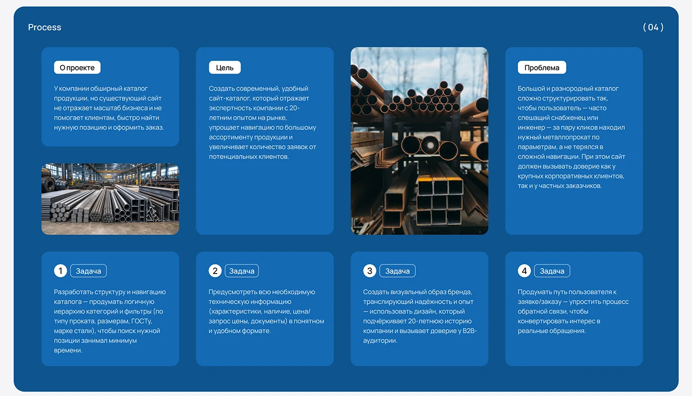

# Blue process board with project, goal and problem cards, tasks 1-4 and industrial photos

**Discipline:** web · **Design type:** Case study slide
**Tags:** case-study, process, blue, cards, white-pills, photos, industrial, cyrillic

## What it is
A deep blue rounded board '(04) Process' with a grid of lighter blue rounded cards: about the project, goal, problem, each with a white label pill, two photos of steel stock, and four task cards with numbered white circles and outlined pills.

## What it means
Organised and reliable; equal cards make a complex brief scannable.

## Techniques
- Tile the brief as equal rounded cards.
- Label each with a white pill.
- Mix in real photos of the material.
- Number tasks with circles.

## Best for
- Case-study briefs
- B2B web process slides
- Blue presentation boards

## Vocabulary
- **Brief card** — A card describing part of a brief.
- **Label pill** — A white capsule naming a card.
- **Task number** — A white circle with a step number.
- **Photo tile** — A card that is a photograph.
