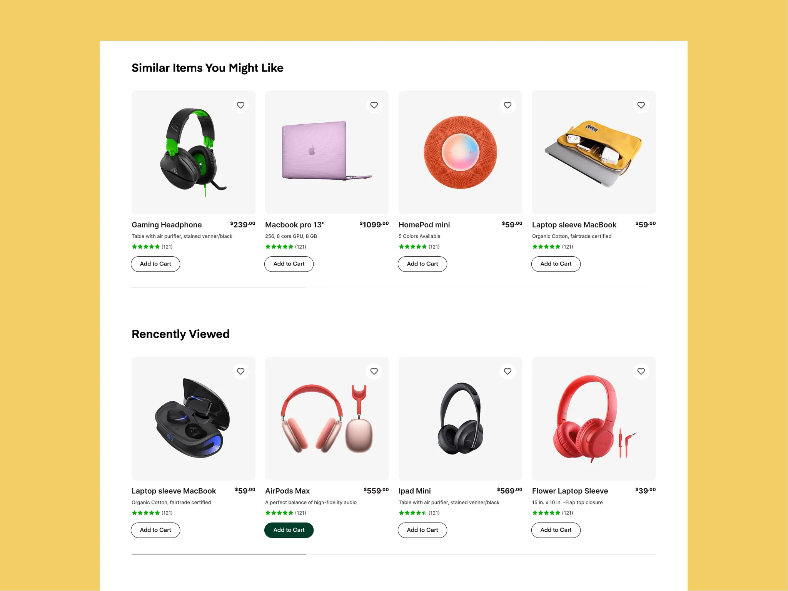

# White product-card rows 'Similar Items You Might Like' and 'Recently Viewed' on a mustard backdrop with hairline progress

**Discipline:** web ·  · **Design style:** Minimalist
**Tags:** e-commerce, product-grid, white, mustard, green, outlined-buttons, hearts, carousel

## What it is
A mustard backdrop with a white panel holding two headings and rows of four grey product tiles each with a heart button, name and price with superscript cents, a spec line, green stars and an outlined Add to Cart pill (one filled dark green), with a thin progress line under each row.

## What it means
Clear and dependable; consistent tiles and a hairline progress bar make carousels readable.

## Techniques
- Use soft grey tiles for products.
- Superscript cents in prices.
- Outline buttons with one filled state.
- Add a thin progress line under carousels.

## Best for
- Product recommendation rows
- Retail carousels
- Mustard and green palettes

## Vocabulary
- **Superscript price** — Cents set small and raised.
- **Carousel progress line** — A thin line showing scroll position.
- **Heart button** — A round wishlist control on a tile.
- **Filled state** — The active button shown with a solid fill.
