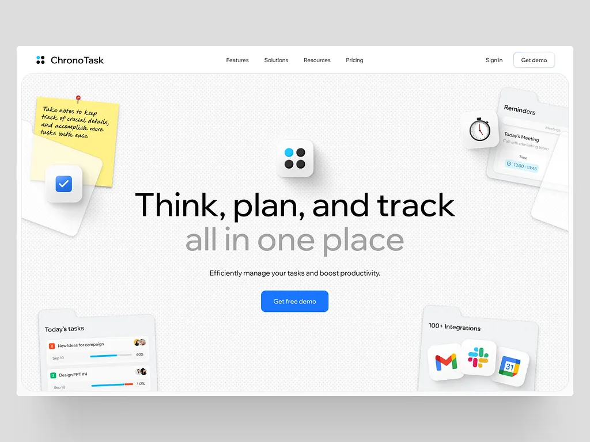

# Textured white hero 'Think, plan, and track all in one place' with a pinned sticky note, 3D icon tiles and folder-shaped widgets in the corners

**Discipline:** web · **Design type:** Landing page hero
**Tags:** saas, productivity, white, blue, sticky-note, 3d-icons, folders, dot-texture

## What it is
A white page with a dotted grey textured field, a centred headline in black and grey, a blue Get free demo button, a logo tile with four dots at the top centre, a yellow pinned note with handwriting and a blue check tile at the left, a stopwatch tile and a reminders folder at the right, and folder-shaped widgets at the bottom for today's tasks and integrations.

## What it means
Playful yet tidy; tactile desk objects make software feel like a well-organised desk.

## Techniques
- Scatter desk-object widgets around a centred headline.
- Shape widgets like folders.
- Use a two-tone headline in black and grey.
- Keep one blue CTA.

## Best for
- Productivity and task-management heroes
- Skeuomorphic light UI
- Blue single-CTA pages

## Vocabulary
- **Sticky note widget** — A yellow pinned note as a UI element.
- **Folder widget** — A card shaped like a folder tab.
- **Two-tone headline** — A headline in black and lighter grey.
- **Dot texture** — A fine dot pattern on the background.
