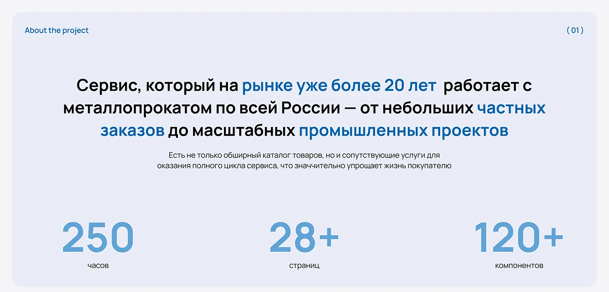

# About-the-project slide with blue highlighted statement and three giant stats

**Discipline:** web ·  · **Design style:** Minimalist
**Tags:** case-study, intro, light, blue, stats, centered, cyrillic, numbers

## What it is
A pale lavender rounded panel labelled 'About the project (01)'. A centred bold statement highlights phrases in blue, a small grey paragraph follows, and three large pale blue numerals (250, 28+, 120+) with tiny captions sit in a row at the bottom.

## What it means
Clear and factual; blue highlights and big numbers make credentials skimmable.

## Techniques
- Highlight key phrases in brand blue inside a bold centred statement.
- Show project scale with three big light numerals.
- Keep the panel very pale with rounded corners.
- Number the section in the top corner.

## Best for
- Case-study introductions
- Project summary slides
- B2B portfolio pages

## Vocabulary
- **Highlighted statement** — A paragraph with key phrases coloured.
- **Stat row** — Three or four large numbers in a line.
- **Section counter** — A number showing slide position.
- **Pale panel** — A softly tinted container.
