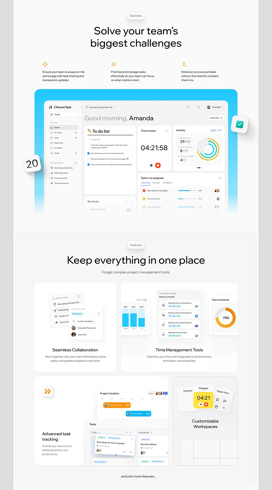

# Task-manager landing sections: three icon columns, a dashboard in a cyan frame, and a bento of feature cards

**Discipline:** web ·  · **Design style:** Corporate & Clean-Tech
**Tags:** saas, productivity, white, cyan, orange, bento, dashboard, icons

## What it is
A white page with a 'Solutions' pill and 'Solve your team's biggest challenges', three columns with orange line icons and short copy, a large dashboard in a cyan rounded frame with a floating green check tile and a date tile, then a 'Features' section 'Keep everything in one place' with a bento of cards (collaboration, time management, task tracking, customisable workspaces) each with a UI fragment.

## What it means
Clear and friendly; a bright frame and UI fragments explain productivity features visually.

## Techniques
- Frame the dashboard in a saturated cyan panel.
- Float small sticker-like tiles beside it.
- Show each feature as a UI fragment in a bento card.
- Use orange line icons.

## Best for
- Productivity and task-management SaaS
- Feature bento sections
- Cyan and orange accents

## Vocabulary
- **Dashboard frame** — A coloured panel holding a product screenshot.
- **UI fragment card** — A card showing a cropped part of the interface.
- **Floating tile** — A small sticker-like tile outside the frame.
- **Solutions pill** — A capsule labelling a section.
