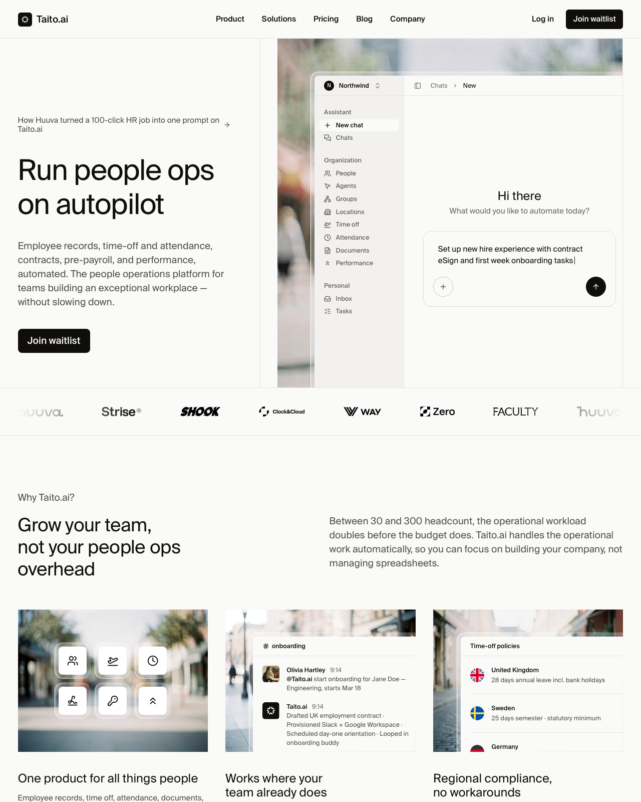

# Quiet SaaS landing with product-in-context hero

**Discipline:** web ·  · **Design style:** Minimalist
**Tags:** saas, landing-page, minimal, warm-neutral, product-ui, blurred-photo, sans-serif, monochrome

## What it is
A long-scroll landing page for an AI people-ops tool. A warm off-white page with black text and a single black button. The hero splits into a left text column (small link, large light-weight headline, grey paragraph, one CTA) and a right panel where a realistic app window floats over a blurred, desaturated street photo. Below sit a strip of grey customer logos, a two-column 'why' section, and three cards that each pair a blurred photo with a small UI fragment.

## What it means
It feels calm, confident and trustworthy, like software that removes work instead of adding it. The restraint says the product is mature. The out-of-focus photography adds human warmth to what would otherwise be a cold dashboard, and keeps the eye on the crisp UI.

## Techniques
- Show the real product UI as the hero image, floating over a soft-focus photograph so the interface is the only sharp thing on the page.
- Use one accent-free palette: off-white, near-black and mid-grey. Hierarchy comes from size, weight and grey value rather than colour.
- Set headlines large but light-weight with tight leading so they read as calm statements rather than shouts.
- Repeat one card recipe (blurred photo behind, small crisp UI fragment in front) so each feature feels part of a family.
- Limit calls to action to a single black pill/rect button, repeated in the nav and hero.
- Run customer logos in a desaturated horizontal strip with hairline borders to separate sections without heavy dividers.
- Split the section headline and body into left and right columns with a wide gap, giving editorial breathing room.
- Type the placeholder prompt in the mock UI with a visible caret so the demo tells the product story on its own.

## Best for
- B2B SaaS and AI tools that want to look calm and credible
- Early-stage products whose UI is the strongest asset
- Operations, HR, finance or legal tools aimed at busy professionals
- Waitlist and early-access launches with one clear action

## Vocabulary
- **Product-in-context hero** — A hero image showing the actual interface placed in an environment (here a blurred street) instead of a flat screenshot.
- **Soft-focus backdrop** — A deliberately blurred photo used as texture and mood so foreground content stays sharp.
- **Logo strip** — A row of customer or partner logos, usually greyscale, used as quiet social proof.
- **Eyebrow** — A small line of text above a headline that gives context or a label.
- **Hairline border** — A 1px low-contrast rule used to divide areas without adding visual weight.
- **Single-CTA discipline** — Keeping one primary action style across the page so the next step is never in doubt.
