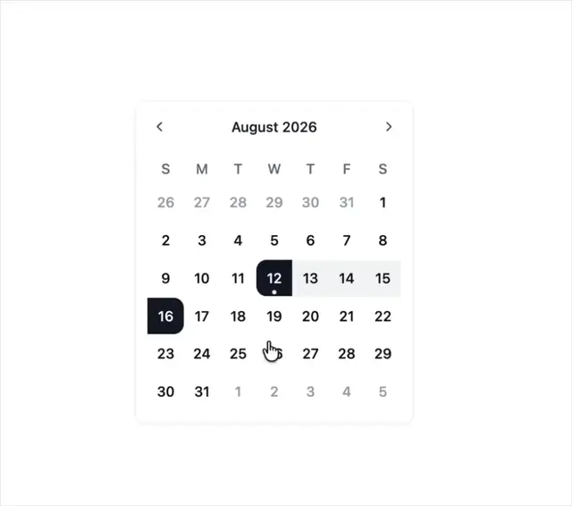

# August 2026 date-range picker with black rounded endpoint tiles on the 12th and 16th, a pale band between them and faded neighbours

**Discipline:** web · **Design type:** UI components
**Tags:** component, calendar, date-range, white, black, grey, selection, cursor

## What it is
A white card with month navigation arrows and 'August 2026', weekday letters and a grid of dates where 12 (with a dot) and 16 are black tiles with rounded outer edges, the dates between are on a pale grey band and out-of-month days are light grey, with a hand cursor near 25.

## What it means
Clear and simple; black endpoints and a soft band show the range at a glance.

## Techniques
- Show endpoints as black rounded tiles.
- Fill the range with a pale band.
- Fade out-of-month dates.
- Add a hover cursor.

## Best for
- Date-range pickers
- Booking and scheduling
- Minimal calendar components

## Vocabulary
- **Range selection** — A start and end date with a highlighted span.
- **Endpoint tile** — The filled tile at each end of a range.
- **Range band** — The tinted strip connecting endpoints.
- **Adjacent-month day** — A faded date from another month.
