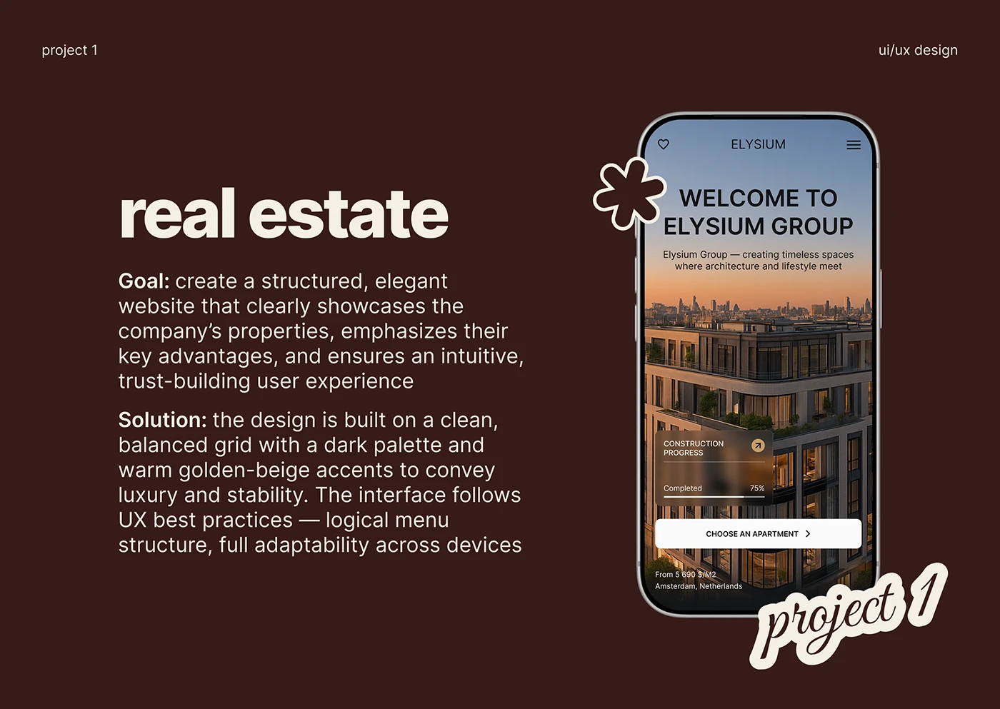

# 'real estate' project slide with goal and solution text, mobile screen and flower sticker

**Discipline:** web · **Design type:** Case study slide
**Tags:** case-study, chocolate-brown, cream, phone-mockup, sticker, script, real-estate, bold-lead-in

## What it is
A deep brown slide with a huge cream 'real estate' title, Goal and Solution paragraphs with bold lead-ins, a phone showing the Elysium sunset hero, a cream-outline flower sticker on its corner and a script 'project 1' sticker.

## What it means
Warm and consistent; the same template across projects builds a series.

## Techniques
- Repeat one slide template for every project.
- Overlap outline stickers on the device.
- Bold the lead-ins.
- Use cream on chocolate.

## Best for
- Web-design case study decks
- Portfolio project slides
- Real-estate UI projects

## Vocabulary
- **Slide template** — A reusable layout across projects.
- **Outline sticker** — Shapes with a thick contrasting border.
- **Bold lead-in** — A bold phrase opening a paragraph.
- **Project counter** — A script label numbering a project.
