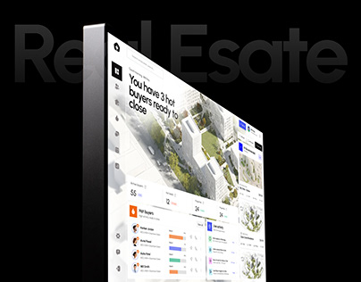

# Real Estate Dashboard on Black Cover

**Discipline:** web · **Design type:** Project cover
**Tags:** dashboard, black, 3d-slab, real-estate, cover, map

## What it is
A cover with oversized ghosted 'Real Estate' lettering behind a dark screen slab showing a bright dashboard with aerial building images and data cards.

## What it means
Black lets the colorful UI glow and feels high-end. Ghost lettering says the subject without competing.

## Techniques
- Faint giant title text behind the device
- Screen shown as a thick 3D slab with reflection
- Aerial imagery inside cards for context
- Bright UI on black for contrast
- Bold headline in the product ('3 hot buyers')

## Best for
- Real estate and CRM projects
- Case-study covers
- Dark showcase presentations

## Vocabulary
- **Ghost lettering** — Large low-contrast text used as backdrop.
- **Screen slab** — A thick 3D-rendered display.
- **Aerial card** — A card featuring overhead photography.
