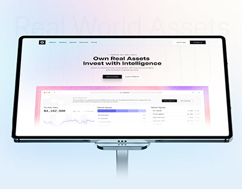

# Real-World Assets Site on Tablet

**Discipline:** web · **Design type:** Device mockup scene
**Tags:** tablet, ghost-type, invest, pastel, stand, fintech, cover

## What it is
A pale gradient cover with a giant faint 'Real World Assets' title behind a tablet on a stand showing a white investment site with a centred headline and a dashboard with a pastel gradient frame.

## What it means
A light glassy scene feels trustworthy, and the ghost title supplies context without clutter.

## Techniques
- Ghost title behind the tablet
- Pastel frame around an inner dashboard image
- Slim silver stand as a support
- Centred bold headline in the hero
- Soft pink and blue gradient backdrop

## Best for
- Investment and fintech websites
- Tablet mockup covers
- Clean light presentations

## Vocabulary
- **Framed dashboard** — A dashboard image inside a coloured border in a hero.
- **Tablet stand** — A slim support holding a tablet upright.
- **Pastel backdrop** — A soft light gradient behind a subject.
