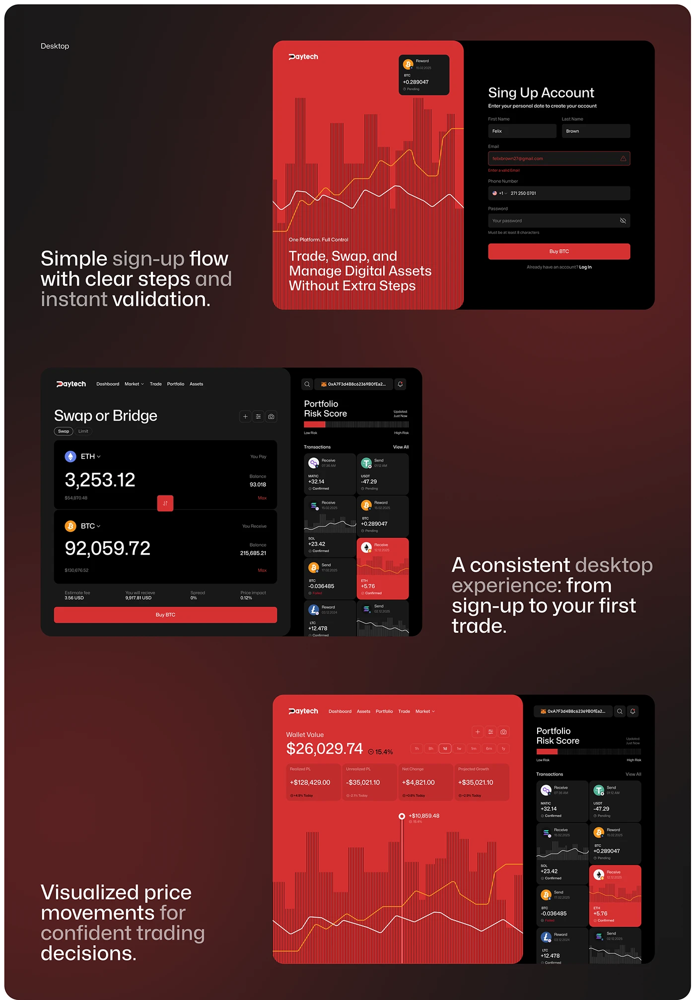

# Red and Black Crypto Desktop Flow

**Discipline:** web · **Design type:** Dashboard
**Tags:** crypto, desktop, red, black, sign-up, swap, chart, dashboard

## What it is
A dark red presentation of three desktop screens with captions: a split sign-up page with a red chart panel, a swap or bridge screen next to a portfolio risk list, and a wallet chart page with a black side panel of transactions.

## What it means
A striped red data texture and black panels unify every screen, and the big captions narrate the flow.

## Techniques
- Red striped chart as the identity texture
- Split screens half red and half black
- Captions beside each screen in bright and dimmed words
- Reused transaction cards across screens
- Bold red button on black forms

## Best for
- Crypto and trading web apps
- Desktop flow presentations
- Data-heavy dark UIs

## Vocabulary
- **Split layout** — A page divided into two contrasting halves.
- **Flow caption** — A large sentence describing what a screen shows.
- **Data texture** — A chart pattern used as a decorative graphic.
