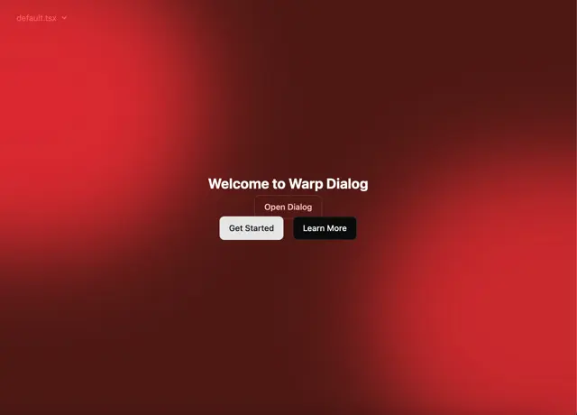

# Deep red mesh of blurred blobs with a small 'Welcome to Warp Dialog' title and three buttons in the centre

**Discipline:** web ·  · **Design style:** Glassmorphism
**Tags:** background, gradient, red, mesh, blur, dialog-trigger, buttons, dark

## What it is
A screen of dark maroon with large blurred bright red blobs at the upper left and lower right, a white 'Welcome to Warp Dialog' heading at the centre, an outlined Open Dialog button and two buttons (light Get Started, black Learn More), and a small file name in the corner.

## What it means
Warm and dramatic; blurred red light gives plain buttons a stage.

## Techniques
- Use a blurred red mesh as the backdrop.
- Keep the foreground minimal.
- Contrast a light and a dark button.
- Add a code-file label in the corner.

## Best for
- Hero and demo backgrounds
- Red gradient brands
- Dialog component demos

## Vocabulary
- **Mesh gradient** — A blend of blurred colour blobs.
- **Blob glow** — A large soft-edged light shape.
- **Demo stage** — A background used to present a component.
- **Button pair** — A light and a dark button beside each other.
