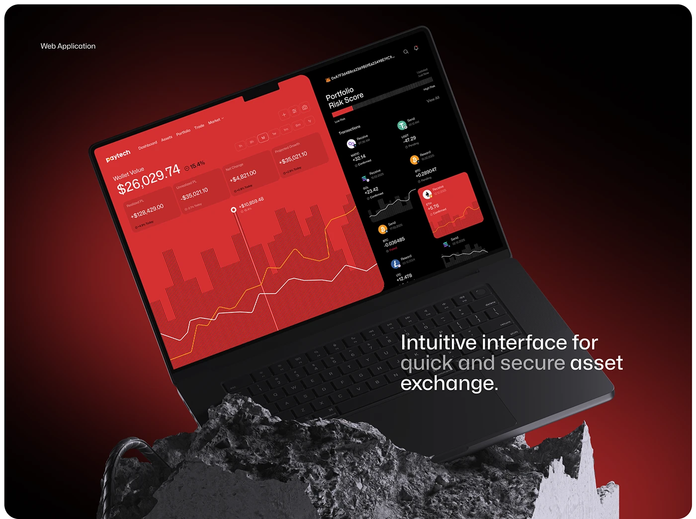

# Red Crypto Web App on Tilted Laptop over Stone

**Discipline:** web · **Design type:** Device mockup scene
**Tags:** laptop, red, black, crypto, stone, dashboard, tilted

## What it is
A dark red vignette panel labelled Web Application with a laptop tilted on rough grey stone, showing a red wallet chart page with a striped bar chart and orange line and a black side panel with portfolio risk score and transactions, and a headline about an intuitive interface for quick secure asset exchange.

## What it means
Rough stone against a glossy black laptop and red UI gives tension and drama.

## Techniques
- Laptop tilted steeply on stone
- Red striped chart as the identity texture
- Split red and black UI
- Headline with dimmed words
- Dark red radial vignette

## Best for
- Crypto web app covers
- Dark red brand systems
- Dramatic laptop mockups

## Vocabulary
- **Stripe chart** — A chart made of thin vertical lines.
- **Stone stage** — Rough rock used as a product base.
- **Split UI** — A screen divided into two colour zones.
