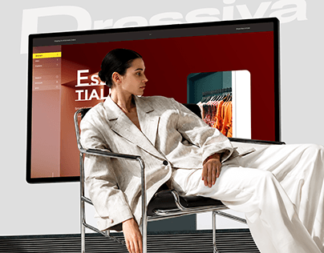

# Red Fashion Site with Model on Chair

**Discipline:** web ·  · **Design style:** 3D & Surreal
**Tags:** fashion, monitor, model, chair, red, ghost-type, photo-composite

## What it is
A cover with a pale grey ground, a monitor showing a deep red fashion website, a model in a pale suit seated on a chrome chair in front of it, and giant faint 'Dressiva' lettering across the top.

## What it means
The model in front of the screen ties the site to the brand's fashion world, and the deep red screen glows against the pale room.

## Techniques
- Real model composited in front of the monitor
- Deep red site as the colour anchor
- Pale wardrobe against a red screen
- Ghost brand name across the top
- Chrome furniture as a styling prop

## Best for
- Fashion e-commerce websites
- Website covers with people
- Editorial-feeling mockups

## Vocabulary
- **Composite mockup** — A device and a person photo combined in one scene.
- **Tonal contrast** — A pale subject set against a dark saturated field.
- **Styling prop** — A furniture item chosen to support the mood.
