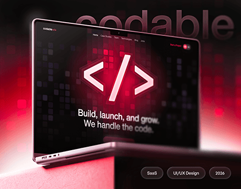

# Black laptop with a glowing red code-bracket icon over a pixel-grid glow and a ghost 'codable' title on a pink plinth

**Discipline:** web ·  · **Design style:** Retro & Pixel
**Tags:** laptop-mockup, dark, red, pixel-glow, ghost-title, saas, tags, project-cover

## What it is
A black-and-red scene with a big ghost 'codable' at the top, a laptop showing a black site with a glowing red hexagon holding a code symbol, a dark pixel-square grid glowing red at the edges, the headline 'Build, launch, and grow. We handle the code.' and pill tags (SaaS, UI/UX Design, 2026) at the bottom on a pink plinth.

## What it means
Techy and intense; red glow on black feels like a compile-time heat.

## Techniques
- Light the scene from below in red.
- Use a pixel-square grid as texture.
- Set a ghost title behind the laptop.
- Add project tags in pills.

## Best for
- Developer and SaaS project covers
- Red-black tech brands
- Glow-lit mockups

## Vocabulary
- **Pixel glow** — A grid of dark squares lit by coloured light.
- **Hexagon icon** — An icon inside a six-sided shape.
- **Project tags** — Pills listing type, discipline and year.
- **Underlit scene** — Lighting coming from below.
