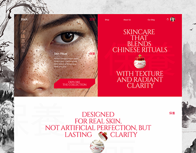

# Chinese-ritual skincare site in red and white with ink-wash mountains and a freckled close-up

**Discipline:** web ·  · **Design style:** Editorial
**Tags:** skincare, red, white, ink-wash, serif, chinese, close-up, split-hero

## What it is
A page over grey ink-wash mountain art: a split hero with a macro photo of a freckled eye and cheek at left and a vivid red panel at right with centred white serif text about Chinese rituals and a jar product, and a white section with red serif 'Designed for real skin' and a faint red glyph background.

## What it means
Cultural and refined; saturated red and ink wash feel ritualistic and premium.

## Techniques
- Split hero into photo and solid red panel.
- Use ink-wash art as the page backdrop.
- Centre serif copy with product in the line.
- Add faint large characters as texture.

## Best for
- Heritage skincare and beauty brands
- Culture-inspired sites
- Red and white luxury identities

## Vocabulary
- **Ink-wash art** — Brush landscapes in soft grey.
- **Macro portrait** — An extreme close-up of skin or eye.
- **Inline product** — A product image inside a line of text.
- **Ghost glyph** — A faint large character behind text.
