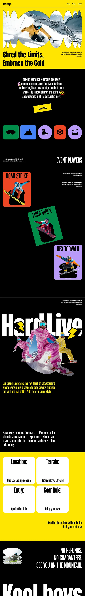

# Retro snowboarding site: yellow and black sections, coloured icon tiles and tilted athlete cards

**Discipline:** web · **Design type:** Landing page
**Tags:** retro, snowboarding, yellow, black, condensed-type, tilted-cards, blob-crop, icons

## What it is
A tall page with a yellow hero where a skier photo sits inside a wavy blob shape above 'Shred the Limits, Embrace the Cold', a black section with a yellow button and five coloured icon tiles, tilted athlete cards in orange, green and purple, a huge cropped 'Hard Live' title with photos, a yellow rules grid and a giant closing wordmark.

## What it means
Loud, retro and irreverent; saturated colour blocks give a 90s board-sport feel.

## Techniques
- Crop hero photos in wavy blob masks.
- Alternate yellow and black full-width sections.
- Tilt athlete cards on bright fills.
- Use tall condensed type for headlines and a giant cropped closing word.

## Best for
- Sports and youth culture brands
- Retro-styled sites
- Event and club microsites

## Vocabulary
- **Blob mask** — An organic wavy shape used to crop an image.
- **Athlete card** — A coloured card presenting one person.
- **Icon tile** — A rounded coloured square with a pictogram.
- **Cropped closer** — A giant word cut at the bottom edge.
