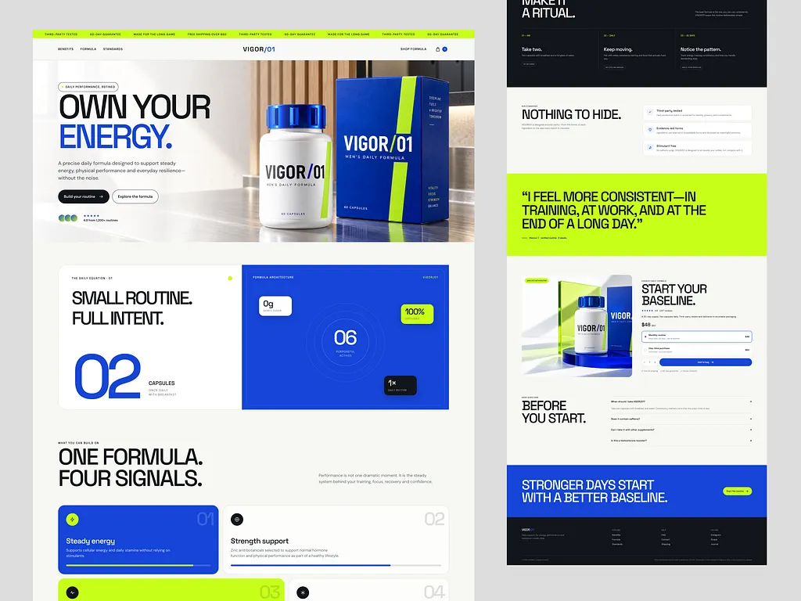

# Men's supplement landing page in royal blue, lime and off-white

**Discipline:** web · **Design type:** E-commerce landing page
**Tags:** landing-page, supplement, royal-blue, lime, bold-type, bento, testimonial, dark-footer

## What it is
A long landing page with a lime ticker at the top, minimal nav, a hero of a big black-and-blue headline 'OWN YOUR ENERGY.' next to a product bottle and box, a two-part card with a huge numeral 02 and a blue formula panel of stat chips, four feature cards (one blue, one lime), a black ritual section, lime testimonial, product buy box, FAQ, blue CTA and dark footer.

## What it means
Confident, clinical and energetic; strong colour blocks feel like sports performance.

## Techniques
- Set headlines in heavy grotesque caps with one blue word.
- Pair a huge numeral with a small caption for a stat moment.
- Alternate cream, blue, lime and black full-width bands.
- Use a blue product box to echo the palette in the hero.
- Present features as numbered cards with lime highlights.

## Best for
- Performance and wellness DTC brands
- Single-product landing pages
- Brands wanting sport-like confidence

## Vocabulary
- **Colour band** — A full-width section in one solid colour.
- **Ticker strip** — A scrolling top bar of short claims.
- **Numeral stat** — A giant number as a design element.
- **Buy box** — The purchase panel with price and options.
