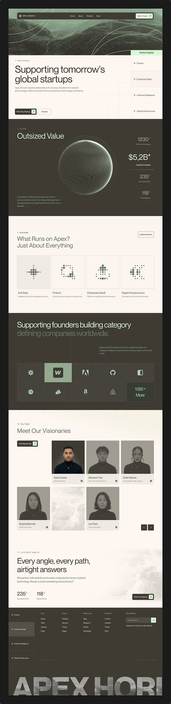

# Long venture-capital page in sage, cream and charcoal with contour sphere, dot-matrix icons and duotone team

**Discipline:** web ·  · **Design style:** Warm & Organic
**Tags:** venture-capital, sage-green, cream, charcoal, contour-sphere, dot-icons, duotone, giant-footer-wordmark

## What it is
A tall page with a sage duotone topographic hero and pill nav, a big statement heading, a charcoal 'Outsized Value' section with a wireframe contour sphere and serif stats, cream tiles with dot-matrix icons for focus areas, a logo grid with a sage highlight tile, a duotone team grid, a closing statement and a footer with a giant cropped wordmark.

## What it means
Sophisticated and calm; muted sage with contour art feels like serious capital.

## Techniques
- Use contour-line art as hero graphics.
- Draw icons from dot matrices.
- Duotone team portraits.
- Alternate cream and charcoal sections.

## Best for
- Venture capital and finance firms
- Muted premium sites
- Wireframe-art identities

## Vocabulary
- **Contour sphere** — A globe drawn with topographic lines.
- **Dot-matrix icon** — An icon made of a dot grid.
- **Duotone portrait** — A photo in two tones.
- **Sage duotone** — A green-grey two-tone treatment.
