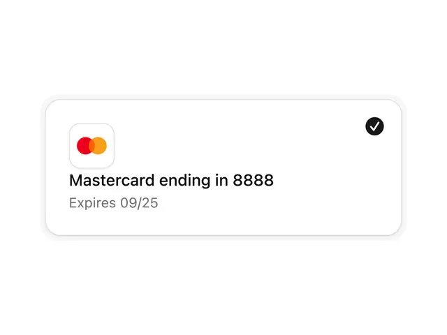

# White payment-method card with a Mastercard tile, 'Mastercard ending in 8888', 'Expires 09/25' and a black check in the corner

**Discipline:** web ·  · **Design style:** Minimalist
**Tags:** component, payment-card, selected, white, black-check, mastercard, shadow, minimal

## What it is
A wide white rounded card with a soft shadow and a faint outer glow, a small rounded tile holding red and orange overlapping circles, a bold line 'Mastercard ending in 8888', a grey 'Expires 09/25' and a black check circle at the top right showing it is selected.

## What it means
Reassuring and simple; a single black check makes the chosen method clear.

## Techniques
- Show a brand mark in a rounded tile.
- Use bold title and grey sub line.
- Mark selection with a black check.
- Add a soft shadow ring.

## Best for
- Payment method lists
- Selected-state cards
- Checkout components

## Vocabulary
- **Payment method card** — A card showing a saved payment method.
- **Selected indicator** — A check showing the chosen item.
- **Brand tile** — A small square holding a logo.
- **Expiry line** — A grey line stating expiration date.
