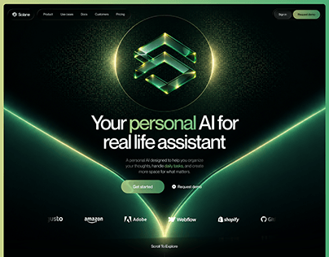

# Scaire AI assistant hero: a glowing green diamond icon over 'Your personal AI for real life assistant'

**Discipline:** web · **Design type:** SaaS landing page · **Design style:** Dark & Neon
**Tags:** ai, saas, black, neon-green, hero, integrations

## What it is
A black landing hero with a top nav (Product, Use cases, Docs, Customers, Pricing), a glowing green faceted diamond icon radiating light rays and forming a V-shape, a headline 'Your personal AI for real life assistant' with 'personal' in green, 'Get started' and 'Request demo' buttons, and a row of partner logos (justo, amazon, Adobe, Webflow, shopify).

## What it means
Futuristic and premium; the glowing gem icon gives an abstract AI assistant a striking, ownable symbol.

## Techniques
- Use a glowing 3D icon with radiating light rays as the hero.
- Let the icon's light form a V leading to the headline.
- Colour only the emotionally key word in the headline.

## Best for
- AI assistant products
- Dark-mode SaaS heroes
- Icon-led brand identities

## Vocabulary
- **Radiating rays** — Light lines emanating outward from a glowing object.
- **Hero icon** — A central graphic symbol representing the product.
