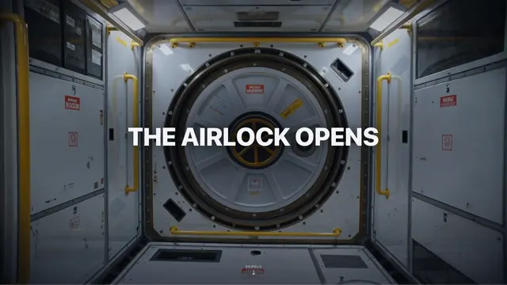

# Full-bleed photo of a space-station airlock hatch with a white caps title 'THE AIRLOCK OPENS' and a small scroll cue

**Discipline:** web · **Design type:** Landing page hero
**Tags:** hero, photography, space, airlock, white-type, scroll, cinematic, symmetry

## What it is
A symmetrical photograph of a grey space-station module with a large round hatch at the centre, yellow handrails and warning labels, and a bold white caps title 'THE AIRLOCK OPENS' across the middle with a tiny 'SCROLL' marker at the bottom.

## What it means
Dramatic and cinematic; the hatch sets up a reveal as the user scrolls.

## Techniques
- Centre a symmetric photo.
- Place a bold title over the focal object.
- Add a small scroll cue.
- Use the image as a scroll-triggered opening.

## Best for
- Scroll storytelling heroes
- Space and tech landing pages
- Cinematic photo openings

## Vocabulary
- **Symmetric hero** — A hero composed around a centre axis.
- **Scroll reveal** — An animation triggered by scrolling.
- **Focal hatch** — A central object drawing the eye.
- **Overlay title** — Text placed over a photograph.
