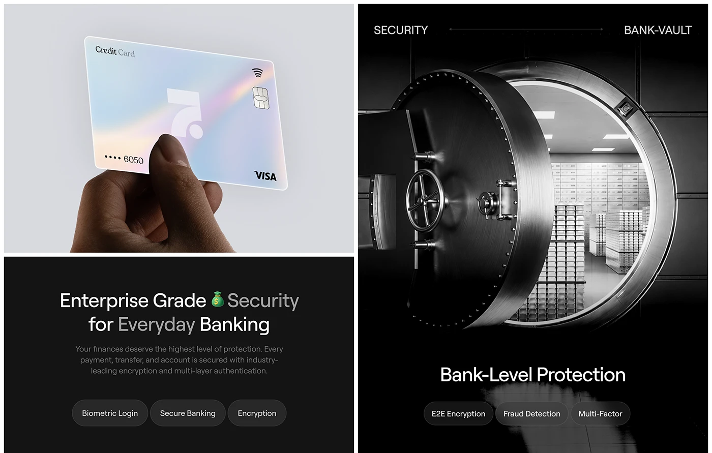

# Iridescent credit card held in a hand, dark security statement with pills, and a black-and-white vault photo with protection pills

**Discipline:** web ·  · **Design style:** Glassmorphism
**Tags:** security, fintech, pearl, black, vault, pills, emoji, photography

## What it is
Three panels: a pale grey panel with a hand holding a rainbow-sheen glass card with a logo cut-out, a black panel 'Enterprise Grade Security for Everyday Banking' with a money-bag emoji, a grey paragraph and three dark pills (Biometric Login, Secure Banking, Encryption), and a tall black-and-white photo of an open bank vault door with 'Bank-Level Protection' and three pills.

## What it means
Strong and reassuring; a vault image makes security tangible while pearl cards keep it modern.

## Techniques
- Use a vault photograph as a security metaphor.
- Line feature pills under a heading.
- Put an emoji inside a serious headline.
- Pair a pearl card with black panels.

## Best for
- Security sections of fintech sites
- Monochrome photo panels
- Pill-feature lists

## Vocabulary
- **Vault metaphor** — A bank vault photo standing for safety.
- **Feature pill** — A capsule naming one feature.
- **Iridescent card** — A card with rainbow sheen.
- **Inline emoji** — An emoji within a headline.
