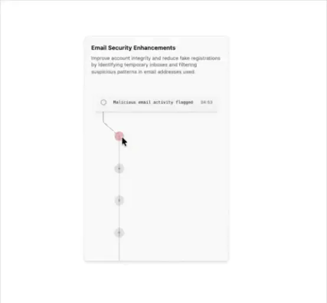

# Card 'Email Security Enhancements' with a monospace flagged-activity row, a vertical line of grey nodes and a pink active node under a cursor

**Discipline:** web · **Design type:** Feature illustration
**Tags:** feature-card, security, timeline, monospace, pink, grey, white, cursor

## What it is
A white rounded card with a bold title and grey description, a monospace row 'Malicious email activity flagged 04:53' with an open circle, a thin line dropping to a pink node under a mouse cursor and three more grey ringed nodes below.

## What it means
Precise and quiet; a vertical event line with one pink node shows an alert in a log.

## Techniques
- Show events on a vertical line.
- Use monospace for log text.
- Highlight the active node in pink.
- Add a cursor to imply interaction.

## Best for
- Security and logging feature cards
- Timeline components
- Minimal product illustrations

## Vocabulary
- **Event timeline** — A vertical line of logged events.
- **Active node** — The highlighted point on the timeline.
- **Log row** — A monospace line with a message and time.
- **Feature card** — A card with a title, text and illustration.
