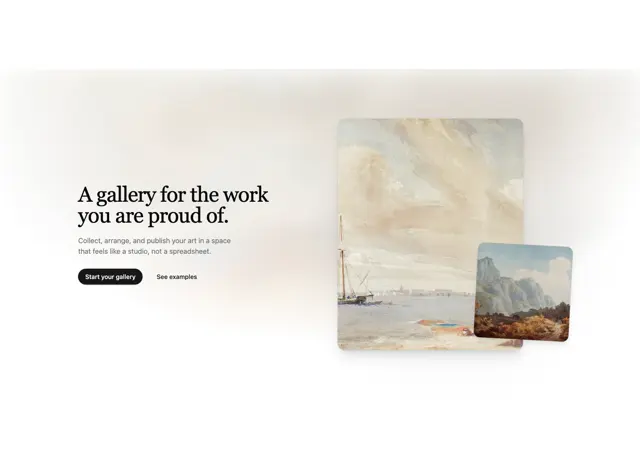

# Hero 'A gallery for the work you are proud of.' in serif with two overlapping painting cards on a warm beige haze

**Discipline:** web · **Design type:** Landing page hero
**Tags:** hero, serif, gallery, paintings, beige, warm, cards, black-button

## What it is
A cream page with a soft warm haze band and a left column with a black serif headline, a grey subline, a black Start your gallery pill and a text link See examples, and at the right a tall card of an old seascape painting with a smaller card of a mountain landscape overlapping its lower right corner, both with soft shadows.

## What it means
Warm and cultured; painterly images with serif type make a tool feel like a gallery.

## Techniques
- Overlap two artwork cards.
- Use serif type and a warm haze.
- Pair a black filled button with a text link.
- Keep copy short.

## Best for
- Art and portfolio platforms
- Serif editorial heroes
- Overlapping image cards

## Vocabulary
- **Overlapping cards** — One image card partly covering another.
- **Warm haze** — A soft beige blur behind content.
- **Serif headline** — A headline in an elegant serif.
- **Text link secondary** — A plain link beside a primary button.
