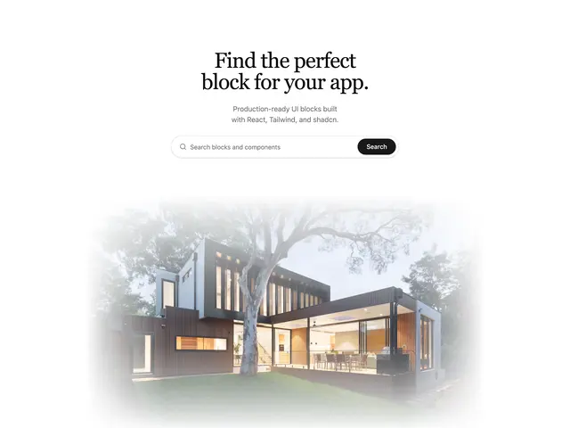

# Search hero 'Find the perfect block for your app.' in black serif with a pill search bar and a modern house photo feathered into white

**Discipline:** web · **Design type:** Landing page hero
**Tags:** hero, serif, search, white, photo-fade, architecture, minimal, black-button

## What it is
A white page with a centred two-line black serif headline, a grey subline, a rounded search field with a magnifier and a black Search pill and, below, a photograph of a modern timber-and-glass house under a large tree whose edges fade softly into the white.

## What it means
Refined and calm; a feathered photo gives a search page an editorial feel.

## Techniques
- Use a serif headline on white.
- Embed a black button in a pill search bar.
- Feather a photo's edges into the background.
- Keep the layout centred.

## Best for
- Search-centred landing pages
- Editorial minimal heroes
- Architecture and real-estate themes

## Vocabulary
- **Feathered photo** — An image whose edges dissolve into the page.
- **Pill search bar** — A rounded search field with an embedded button.
- **Serif headline** — A headline in a serif typeface.
- **Centred hero** — Content aligned on the centre axis.
