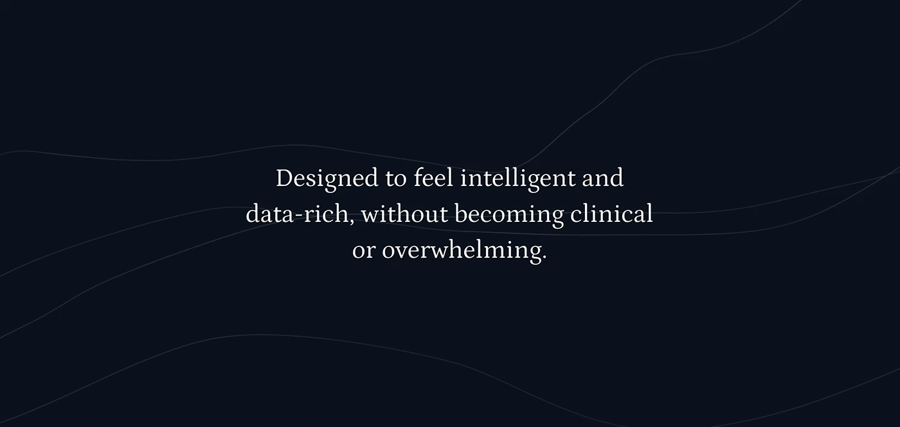

# Centred serif sentence on near-black navy with faint flowing contour curves

**Discipline:** web · **Design type:** Closing banner
**Tags:** statement, dark-navy, serif, contour-lines, minimal, transition, health, centred

## What it is
A near-black navy field with a few very faint curved lines and a three-line centred serif sentence 'Designed to feel intelligent and data-rich, without becoming clinical or overwhelming.'

## What it means
Reflective and calm; a serif line on dark gives a quiet pause.

## Techniques
- Set one serif sentence centred.
- Draw faint flowing lines.
- Use only navy and white.
- Leave generous space.

## Best for
- Case-study section breaks
- Mission statement slides
- Dark refined decks

## Vocabulary
- **Statement banner** — A slide made of one sentence.
- **Faint contour** — Low-contrast wavy lines.
- **Serif on dark** — Light serif text on a dark background.
- **Breathing space** — Empty room around text.
