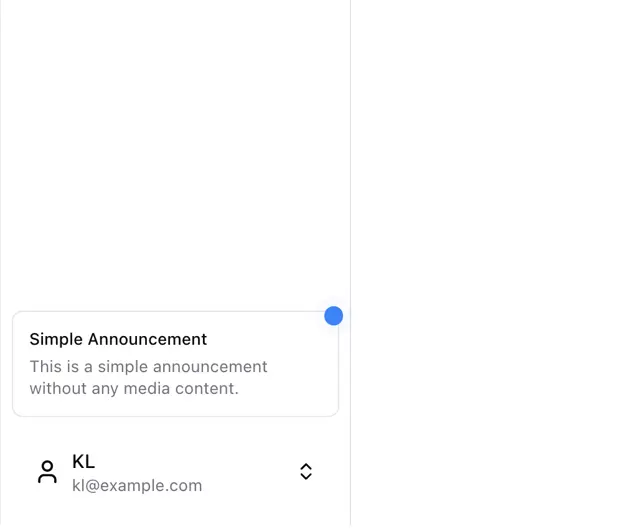

# Empty sidebar with a bordered 'Simple Announcement' card with a blue dot at the bottom, and a user row with icon, initials, email and up-down chevrons

**Discipline:** web ·  · **Design style:** Minimalist
**Tags:** component, sidebar, announcement, user-menu, white, blue-dot, minimal, ui-kit

## What it is
A white screen split by a vertical line; the left sidebar is empty at the top and holds at the bottom a rounded bordered card 'Simple Announcement' with a grey line and a blue notification dot at its corner, then a user row with a person icon, 'KL', 'kl@example.com' and an up-down chevron.

## What it means
Quiet and useful; announcements and account controls sit low where thumbs and eyes expect them.

## Techniques
- Anchor announcement and user rows at the bottom.
- Mark new content with a blue dot.
- Use a bordered rounded card.
- Show a switcher chevron.

## Best for
- Sidebar footers
- App shells
- Announcement cards

## Vocabulary
- **Sidebar footer** — The bottom section of a sidebar with account controls.
- **Announcement card** — A small card notifying about news.
- **Notification dot** — A small coloured dot marking something new.
- **Account switcher** — A row with up-down chevrons to change account.
