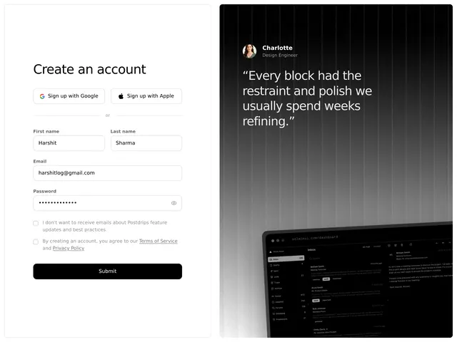

# Split sign-up: a white 'Create an account' form with social buttons on the left and a black striped panel with a quote and a cropped laptop on the right

**Discipline:** web · **Design type:** UI components
**Tags:** sign-up, form, split-screen, white, black, testimonial, laptop, social-login

## What it is
A two-panel screen: at left a white area with a light title, Google and Apple buttons, an 'or' divider, first and last name fields, email, a masked password with an eye icon, two checkboxes and a wide black Submit; at right a black panel with vertical grey light streaks, a round avatar with name and role, a large white quote and a cropped grey laptop showing an inbox.

## What it means
Trustworthy and focused; a quote and product peek beside the form add confidence.

## Techniques
- Split the screen into form and story.
- Place social sign-in above the form.
- End with a full-width black button.
- Show a cropped laptop on the dark panel.

## Best for
- Sign-up and login pages
- Split-screen auth layouts
- Testimonial-backed forms

## Vocabulary
- **Split-screen auth** — A form on one side and marketing on the other.
- **Social sign-up** — Buttons to register via Google or Apple.
- **Quote panel** — A dark area with a testimonial.
- **Cropped mockup** — A device cut off by the panel edge.
