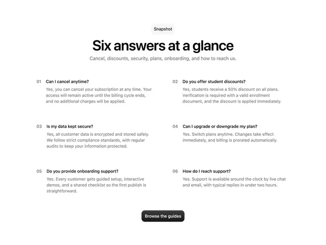

# 'Six answers at a glance' numbered 01 to 06 in two columns with bold questions and grey answers, and a black Browse the guides pill

**Discipline:** web · **Design type:** Landing page sections
**Tags:** faq, numbered, two-column, white, black-button, minimal, snapshot, answers

## What it is
A white page with a small pale 'Snapshot' pill, a large bold centred headline, a grey subline, six numbered questions in two columns with bold questions and grey answers, and a black rounded 'Browse the guides' button.

## What it means
Easy and open; showing all answers at once removes the need to expand anything.

## Techniques
- Show all answers openly in a grid.
- Number each item in grey.
- Bold the questions.
- End with one black button.

## Best for
- Short FAQ sections
- Pricing page FAQs
- Minimal support sections

## Vocabulary
- **Open FAQ** — Questions and answers all visible at once.
- **Index number** — A small grey number beside each item.
- **Snapshot pill** — A small label above a heading.
- **Two-column grid** — Content split into two equal columns.
