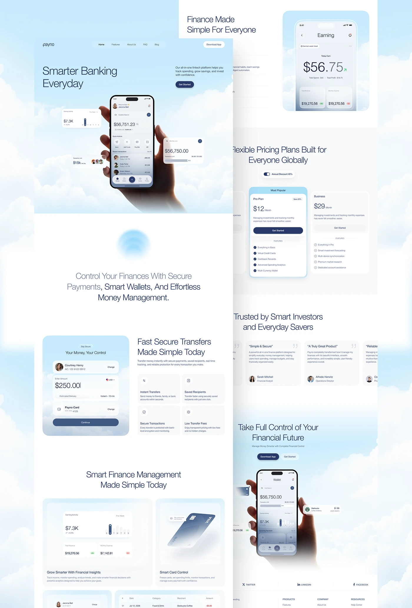

# Fintech landing page on a cloud-and-sky backdrop with a hand holding the app

**Discipline:** web ·  · **Design style:** Corporate & Clean-Tech
**Tags:** fintech, sky, clouds, blue, light-weight-type, phone-in-hand, pricing, testimonials

## What it is
A long page where a photographic cloud sky runs through every section: a hero with 'Smarter Banking Everyday', a hand holding a phone with floating widgets; a statement paragraph over a blue orb; a transfer card with blue gradient; feature cards; pricing with the popular plan tinted; testimonials; CTA and another phone in hand. Text is light navy.

## What it means
Airy, trustworthy and optimistic; clouds evoke lightness and freedom from financial weight.

## Techniques
- Use one continuous sky photograph as the page background.
- Float small stat cards around a hand-held phone.
- Write light-weight navy headlines with one darker phrase.
- Tint the featured pricing card in the sky blue.
- Fade white panels over the clouds between sections.

## Best for
- Fintech and wellness brands wanting an airy tone
- Consumer banking sites
- Products promising ease and calm

## Vocabulary
- **Sky backdrop** — A cloud photo used as a page background.
- **Floating widget** — A small UI card hovering around a device.
- **Blue orb** — A blurred blue sphere used as an accent.
- **Fade panel** — A white panel whose edge fades into the background.
