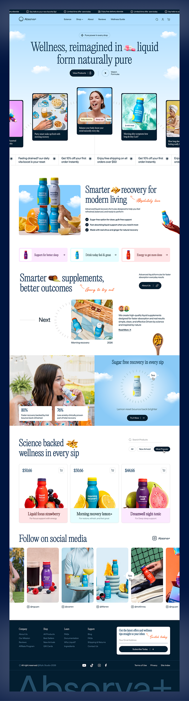

# Sky-Blue Liquid Supplement Landing Page

**Discipline:** web · **Design type:** Landing page
**Tags:** ecommerce, supplements, sky, clouds, serif, script, lifestyle, long-page

## What it is
A tall e-commerce landing page with a cloudy sky hero, a serif headline with inline pill icons, a carousel of tilted lifestyle photo cards, ticker bar, benefit sections with script annotations, product cards in pastel tints, a social gallery and a navy footer with giant brand name.

## What it means
Sky, clouds and juicy fruit photography convey freshness and lightness, and the handwritten orange notes add personality.

## Techniques
- Inline product and pill icons inside serif headlines
- Hand-written script annotations in orange
- Tilted photo card carousel under the hero
- Pastel-tinted product cards per flavour
- Announcement ticker at the top and giant footer wordmark

## Best for
- Supplement, drink and wellness brands
- Playful e-commerce landing pages
- Lifestyle-driven product marketing

## Vocabulary
- **Inline icon** — An icon or image placed within a line of headline text.
- **Script annotation** — A handwritten-style note added next to a heading.
- **Announcement ticker** — A scrolling strip of offers at the top of a site.
