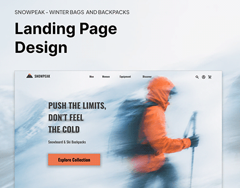

# Snowpeak winter backpack landing page with a motion-blurred hiker in an orange jacket

**Discipline:** web · **Design type:** Landing page hero · **Design style:** Photographic & Cinematic
**Tags:** outdoor, backpacks, winter, motion-blur, orange, hero

## What it is
A snowy hero with a hiker in an orange jacket and backpack streaked by motion blur, condensed uppercase 'Push the limits, don't feel the cold', 'Snowboard & Ski Backpacks' and an orange 'Explore Collection' button, under a 'Landing Page Design' title.

## What it means
Fast and raw; motion blur makes the cold and speed almost physical.

## Techniques
- Use motion blur on the hero photo for energy.
- Match the CTA colour to the jacket.
- Set tagline in condensed uppercase.

## Best for
- Outdoor gear brands
- Sports e-commerce
- Adventure landing pages

## Vocabulary
- **Motion blur** — Streaking that shows movement in a photo.
- **Colour pickup** — Taking the UI accent from the photo.
