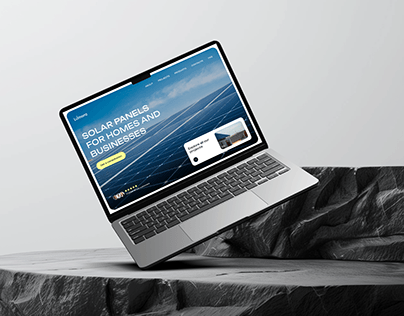

# Solar Site Laptop on Black Rock

**Discipline:** web · **Design type:** Device mockup scene
**Tags:** laptop, rock, solar, grey, balance, energy, cover

## What it is
A laptop showing a blue solar panel website with a yellow CTA, tilted and balanced on a black rock slab against a pale grey backdrop.

## What it means
Dark natural stone against a light grey studio contrasts nicely, and the blue site connects to the energy theme.

## Techniques
- Laptop balancing on a rock edge
- Light grey backdrop with dark stone base
- Photo-hero site with a yellow button
- Tilt for dynamism
- Clean studio lighting

## Best for
- Energy and sustainability sites
- Web case-study covers
- Product staging with natural props

## Vocabulary
- **Balance pose** — A device propped on an edge for a dynamic angle.
- **Stone base** — A rock used as a display pedestal.
- **Yellow CTA** — A bright yellow button on a blue page.
