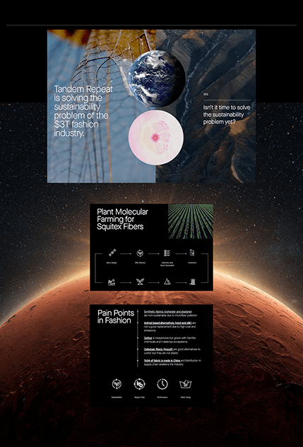

# Pitch slides floating over a starfield and Mars horizon: planets over a plant-fibre photo, a process flow and pain points

**Discipline:** web ·  · **Design style:** Minimalist
**Tags:** pitch-deck, space, mars, dark, planets, flow-diagram, sustainability, monochrome-slides

## What it is
A black starfield with a glowing red Mars horizon and three slides stacked over it: a photo slide of insect wings with an Earth globe and a pink cell orb beside 'Tandem Repeat is solving the sustainability problem of the $3T fashion industry', a black flow-diagram slide with small icons and a crop-field photo, and a black slide listing pain points in fashion with a row of icons.

## What it means
Ambitious and scientific; a planetary backdrop lifts a sustainability pitch to a big-picture story.

## Techniques
- Float slides over a space photograph.
- Use circular photos as planets.
- Show the flow with tiny line icons.
- Keep slides black with white type.

## Best for
- Deep-tech and sustainability pitch decks
- Slide previews on a backdrop
- Space-themed presentations

## Vocabulary
- **Slide over backdrop** — Slides shown floating over a photograph.
- **Planet circle** — A round photo used like a planet.
- **Flow diagram** — Steps connected with lines and icons.
- **Pain-point list** — A list of problems with icons.
