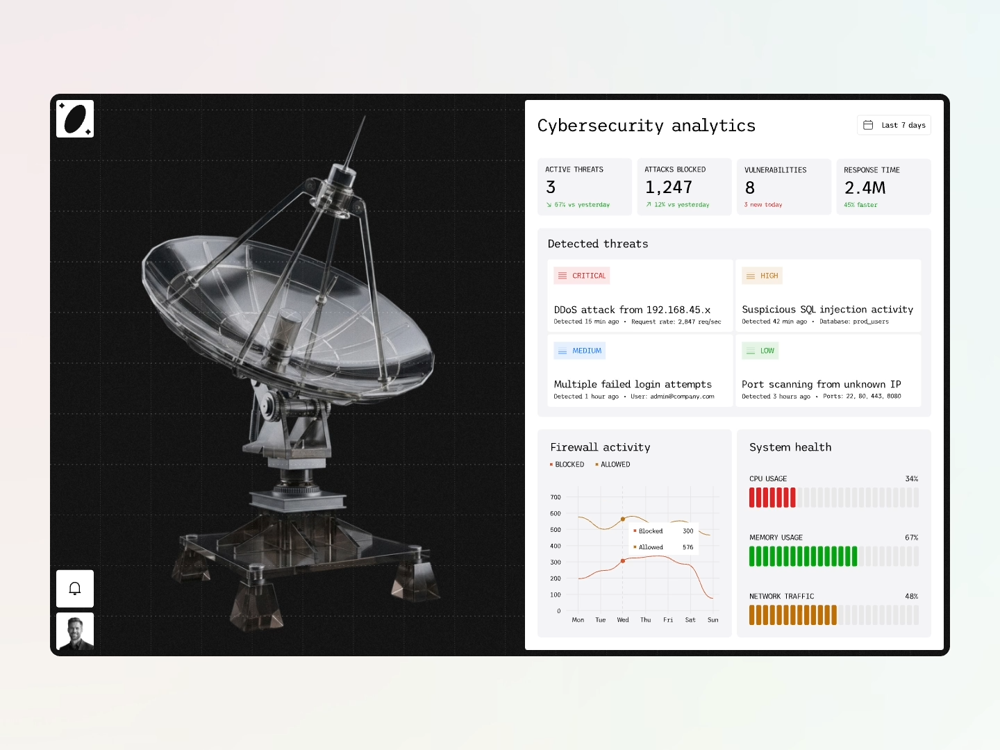

# Split Dashboard with 3D Satellite Dish

**Discipline:** web · **Design type:** Dashboard
**Tags:** dashboard, split-screen, 3d, security, monospace, data, light-dark

## What it is
A framed dashboard split into a black left panel showing a glassy 3D satellite dish with faint grid, and a light right panel with KPI tiles, severity-tagged threat cards, a line chart and segmented bar meters for CPU, memory and network.

## What it means
The dark hero object gives the dashboard a memorable identity and thematic metaphor (listening, monitoring), while the light data side stays readable and orderly.

## Techniques
- Half-dark, half-light split to separate mood from information
- 3D object as a thematic illustration inside a data product
- Small colored severity tags for triage
- Segmented bar meters colored by health level
- Monospace type for data-heavy labels

## Best for
- Security, monitoring and analytics products
- Concept dashboards and case studies
- Products that need a memorable visual metaphor

## Vocabulary
- **Split canvas** — A layout divided into two contrasting halves.
- **Segmented meter** — A bar composed of small discrete blocks that fill to show a value.
- **Severity tag** — A small colored label showing priority level.
