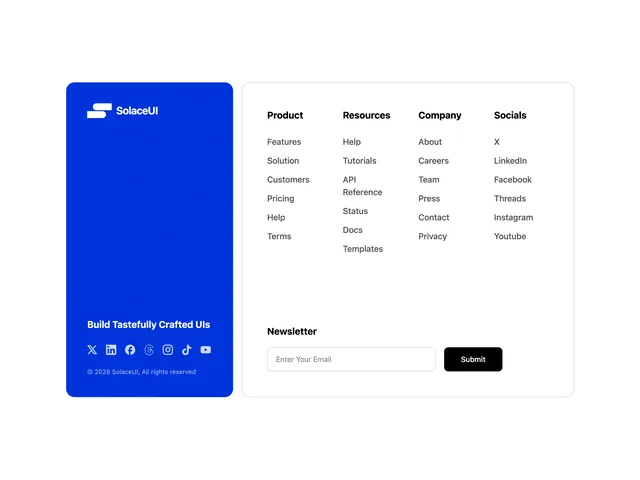

# Split footer: a blue rounded brand panel with logo, tagline and social icons beside a white panel of four link columns and a newsletter field

**Discipline:** web ·  · **Design style:** Warm & Organic
**Tags:** component, footer, blue, white, link-columns, newsletter, social-icons, rounded

## What it is
A white page with a saturated blue rounded panel at the left holding a white logo, a bold 'Build Tastefully Crafted UIs', a row of white social icons and a copyright, and a bordered white panel at the right with four bold-headed link columns (Product, Resources, Company, Socials), a Newsletter heading and an email field with a black Submit button.

## What it means
Confident and organised; a colour panel gives a footer a brand anchor.

## Techniques
- Split the footer into a brand panel and a link panel.
- Use one saturated blue block.
- Keep links in tidy columns.
- Pair the newsletter field with a black button.

## Best for
- Footer components
- Brand-coloured footers
- SaaS and template sites

## Vocabulary
- **Brand panel** — A coloured block holding logo and tagline.
- **Link column** — A vertical list of links under a heading.
- **Newsletter row** — An email input with a submit button.
- **Split layout** — Two panels side by side.
