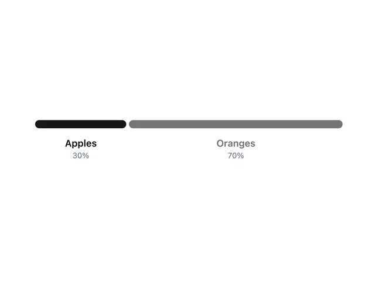

# Single horizontal bar split into a black 30% segment 'Apples' and a grey 70% segment 'Oranges' with labels beneath

**Discipline:** web · **Design type:** Data visualization
**Tags:** chart, proportion, bar, black, grey, labels, minimal, comparison

## What it is
A white frame with a pill-shaped horizontal bar divided into a short black part and a long mid-grey part, and below them centred labels 'Apples 30%' (bold black) and 'Oranges 70%' (grey).

## What it means
Direct and simple; one bar tells the ratio without a legend.

## Techniques
- Split one bar into proportional segments.
- Match label weight to segment colour.
- Place labels under each part.
- Use rounded ends.

## Best for
- Proportion comparisons
- Simple share charts
- Minimal data displays

## Vocabulary
- **Proportion bar** — A bar divided by shares of a whole.
- **Segment label** — Text under a segment naming it and its value.
- **Pill bar** — A bar with fully rounded ends.
- **Contrast pair** — Black and grey used for two categories.
