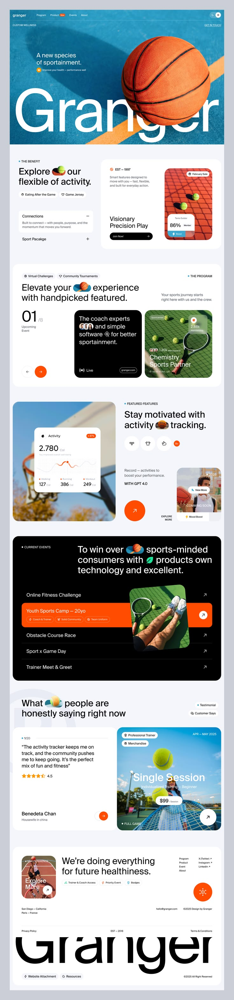

# Sports Wellness Landing with Giant Wordmark

**Discipline:** web · **Design type:** Landing page
**Tags:** sports, long-page, orange, black, white, giant-type, cards, photography

## What it is
A tall landing page for a sports wellness brand: a hero photo of a basketball with a giant white wordmark, inline icon chips in headlines, tennis and basketball photo cards, a black events list with an orange highlighted row, testimonials and a footer with a cropped giant wordmark.

## What it means
Photography with bright orange accents feels athletic and lively, and giant wordmarks bookend the page.

## Techniques
- Giant wordmark overlapped by the hero photo
- Inline photo chips inside headlines
- Black list section with an orange highlighted row
- Rounded photo cards with overlay data cards
- Cropped wordmark as a footer graphic

## Best for
- Sports and fitness brands
- Long editorial landing pages
- Activity and event listings

## Vocabulary
- **Giant wordmark** — A brand name set at enormous scale.
- **Inline chip** — A small image or icon placed inside a headline.
- **Highlighted row** — One list row filled with the accent colour.
