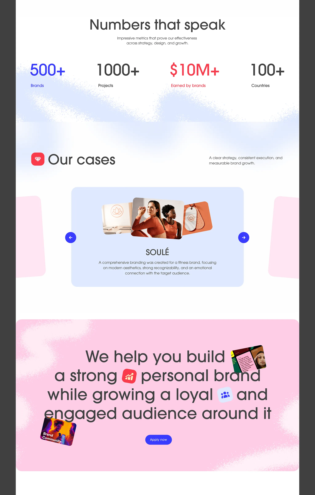

# White agency page with blue and pink spray-paint clouds, coloured stats and a tilted case carousel

**Discipline:** web ·  · **Design style:** Gradient & Aurora
**Tags:** agency, spray-texture, pink, blue, red, stats, carousel, rounded

## What it is
A white page with soft spray-painted blue clouds, a stats row 'Numbers that speak' in blue, black and red, an 'Our cases' section with a lilac card carousel showing a fitness brand with images and blue arrows, and a pink spray panel with a large statement containing inline image and icon chips and a blue Apply button.

## What it means
Friendly and loose; spray texture and coloured numerals give warmth.

## Techniques
- Paint spray clouds behind sections.
- Colour individual stats differently.
- Tilt side cards in a carousel.
- Embed icon chips inline in a statement.

## Best for
- Personal brand and marketing agencies
- Playful light sites
- Stat and case sections

## Vocabulary
- **Spray cloud** — A speckled soft paint shape.
- **Inline icon chip** — A small icon inside a sentence.
- **Stat colouring** — Different colours for each figure.
- **Case carousel** — A slider of project cards.
