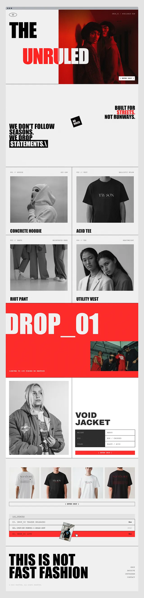

# Streetwear drop site: red half-hero, statement blocks, greyscale product grid, giant DROP_01 band and log-style updates

**Discipline:** web · **Design type:** E-commerce storefront
**Tags:** streetwear, red, black, white, brutalist, condensed-type, product-grid, monospace

## What it is
A very tall page in red, black and white: a hero 'THE UNRULED' half over a red-toned portrait, statement text with a rotated NO RULES sticker, a two-column greyscale product grid with spec labels, a full-width red DROP_01 band with a photo, a jacket feature with a spec table, a row of shirts, a log list with strikethroughs and a huge 'THIS IS NOT FAST FASHION' footer.

## What it means
Loud and raw; red blocks and monospace specs feel like an underground drop.

## Techniques
- Use giant heavy caps with red keywords.
- Show products in greyscale with monospace labels.
- Use a full-width red band as a chapter.
- Style updates as a log with strikethroughs.

## Best for
- Streetwear and drop brands
- Brutalist e-commerce
- Red-black-white identities

## Vocabulary
- **Drop band** — A full-width block announcing a release.
- **Spec label** — A small monospace label with product specs.
- **Log list** — A list styled like a system log.
- **Red half-hero** — A hero split with a red-toned image.
