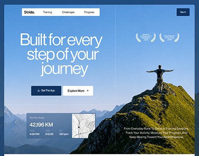

# Stride running app landing: a hiker with arms wide on a green ridge and a run-stats card

**Discipline:** web · **Design type:** Landing page hero · **Design style:** Photographic & Cinematic
**Tags:** fitness, running, mountains, hero, stats-card, blue

## What it is
A full-bleed photo of a hiker with outstretched arms on a green mountain ridge under a blue sky, a white nav pill, 'Built for every step of your journey' in large thin white type, 'Get The App' and 'Explore More' buttons, award laurels, and a translucent card with '42,196 KM' and a route map.

## What it means
Uplifting and aspirational; the summit pose sells achievement more than features.

## Techniques
- Use a triumphant pose as the hero photo.
- Float a live-data card over the landscape.
- Add award laurels for credibility.

## Best for
- Fitness apps
- Outdoor tracking products
- App landing pages

## Vocabulary
- **Laurel badge** — A wreath shape framing an award.
- **Data card** — A small panel showing live figures.
