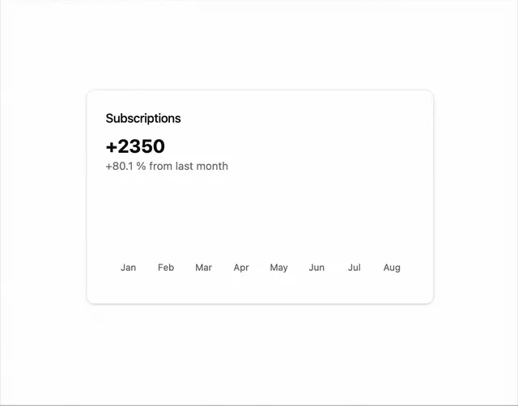

# White stat card 'Subscriptions +2350, +80.1% from last month' with an empty chart area and month labels Jan to Aug

**Discipline:** web ·  · **Design style:** Minimalist
**Tags:** component, stat-card, chart, white, numerals, axis, subscriptions, minimal

## What it is
A white rounded card with a soft shadow, a small title 'Subscriptions', a large bold '+2350', a grey growth caption and a blank chart area above a row of month labels from Jan to Aug.

## What it means
Clean and legible; a big number and small growth caption tell the story before the chart draws.

## Techniques
- Lead with a big bold figure.
- Add a small grey growth line.
- Reserve space for an animated chart.
- Show month labels along the bottom.

## Best for
- Analytics dashboard cards
- Animated chart placeholders
- Minimal stat components

## Vocabulary
- **Stat card** — A card presenting one metric.
- **Growth caption** — A small line describing change versus last period.
- **Axis labels** — Text marking chart categories.
- **Chart canvas** — The blank area where a chart draws.
