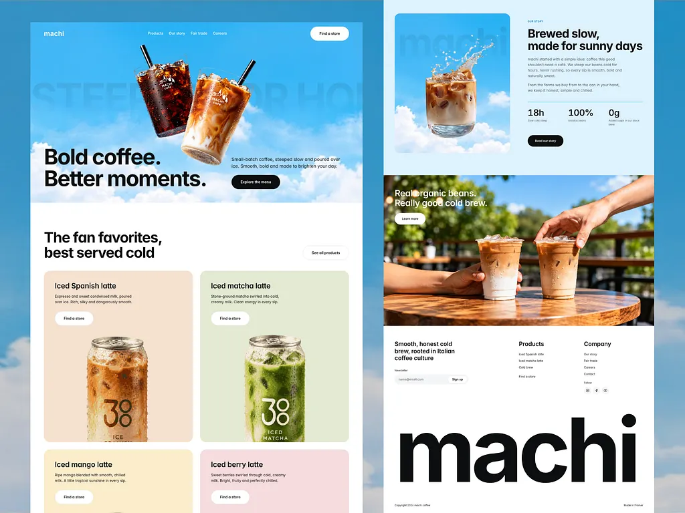

# Cold-brew coffee site with a sky-blue cloud hero and floating cups, pastel flavour cards with cans, a story section and giant 'machi' footer

**Discipline:** web ·  · **Design style:** Photographic & Cinematic
**Tags:** coffee, sky-blue, clouds, pastel-cards, product-can, giant-wordmark, photography, rounded

## What it is
Two page columns over a sky-cloud backdrop: a hero with floating iced coffees and 'Bold coffee. Better moments.' with a black button, a 'fan favorites' section with rounded pastel cards (peach, mint, yellow, pink) holding cans and white buttons; a story block with an iced latte splash photo and stats, a table photo with two iced drinks and a giant black lowercase 'machi' footer wordmark.

## What it means
Fresh and sunny; sky and pastel cards make cold coffee feel bright.

## Techniques
- Float products in a sky hero.
- Tint each flavour card in its own pastel.
- Use a giant lowercase footer wordmark.
- Pair sky photos with warm table photos.

## Best for
- Beverage and coffee brands
- Pastel product-card sites
- Sky-themed heroes

## Vocabulary
- **Floating product hero** — Products suspended in a sky scene.
- **Flavour card** — A tinted card for one variant.
- **Giant footer wordmark** — A huge brand name at the page end.
- **Sky backdrop** — A photo of sky and clouds.
