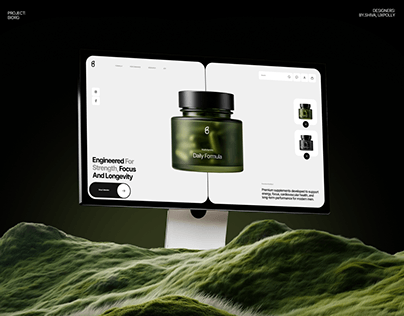

# White site with a dark olive supplement jar on a monitor rising from a huge mossy hill in a black room

**Discipline:** web · **Design type:** Device mockup scene
**Tags:** monitor, moss, olive-green, product-hero, dark, split-screen, supplements, project-cover

## What it is
A black background with a monitor showing a two-panel white site with the headline 'Engineered For Strength, Focus And Longevity' and a green translucent jar 'Daily Formula', standing above a dense green mossy landscape, with small project credits at the corners.

## What it means
Natural and premium; moss and olive glass tie the science product to nature.

## Techniques
- Set the monitor above a textured moss hill.
- Match the site's product colour to the scene.
- Use a split-screen product page.
- Keep the room black.

## Best for
- Supplement and wellness site covers
- Nature-tech contrast
- Product-hero pages

## Vocabulary
- **Moss terrain** — A landscape of dense moss used as a stage.
- **Split-screen hero** — A page split into two panels.
- **Olive glass** — Translucent green packaging.
- **Credit corners** — Small text in the corners.
