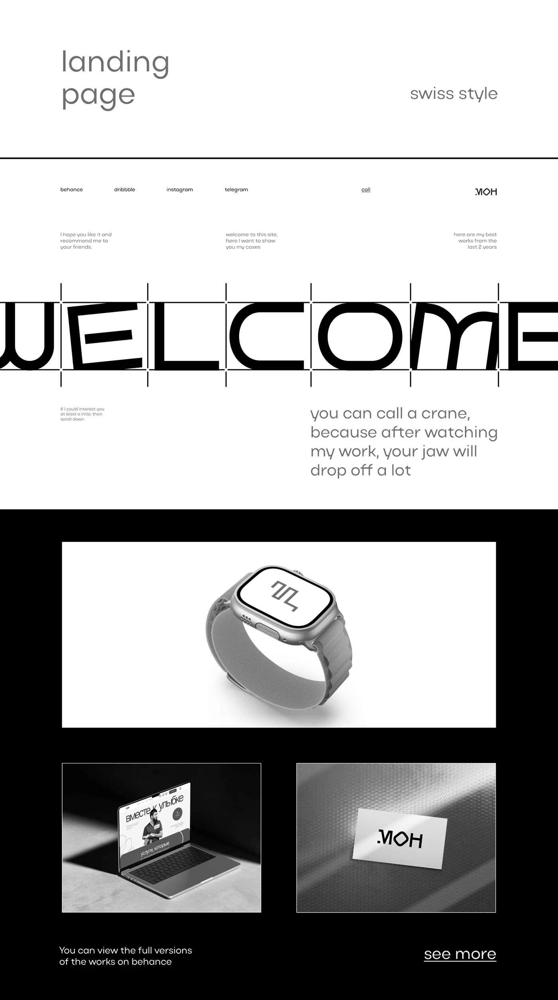

# Swiss-style monochrome landing with a giant cropped WELCOME in geometric letters on guide ticks and black showcase panels

**Discipline:** web ·  · **Design style:** Geometric & Bauhaus
**Tags:** swiss-style, monochrome, geometric-type, guide-ticks, mockups, portfolio, black-and-white, lowercase

## What it is
A white and black long page with a lowercase title 'landing page' and 'swiss style', small nav links, a huge cropped geometric 'WELCOME' with vertical tick guides, small grey copy, a black section with a smartwatch mockup on white, a laptop and a logo business card in monochrome, and a 'see more' link.

## What it means
Precise and confident; visible guide ticks celebrate the grid.

## Techniques
- Show construction ticks around giant letters.
- Crop the word at both edges.
- Use lowercase light text for the rest.
- Switch to a black showcase section.

## Best for
- Swiss and minimalist portfolios
- Monochrome one-pagers
- Type-led designer sites

## Vocabulary
- **Guide ticks** — Small vertical lines marking letter boundaries.
- **Cropped word** — A word cut by both frame edges.
- **Monochrome showcase** — Mockups in greyscale on black.
- **Lowercase voice** — Text set in all lowercase.
