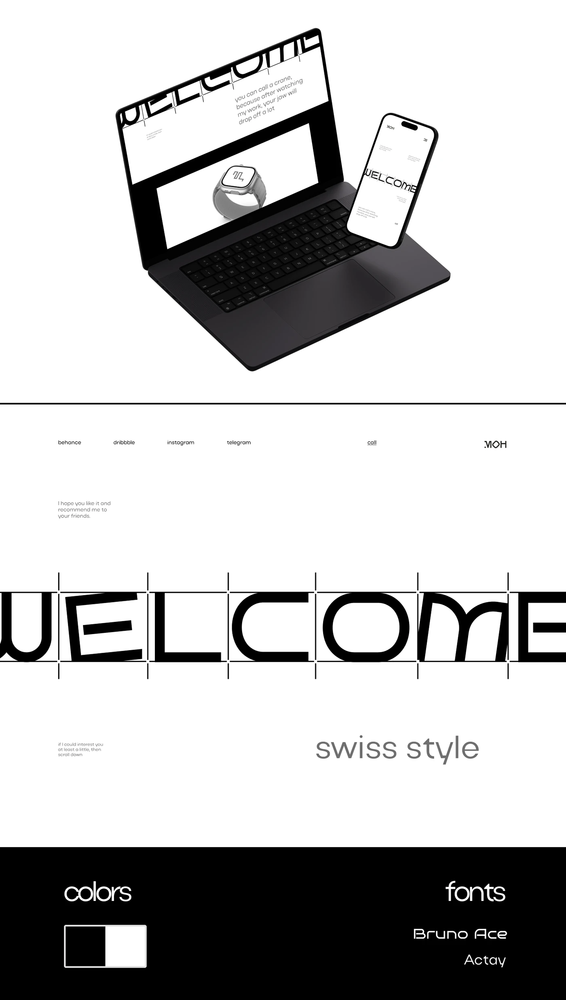

# Monochrome Swiss-style portfolio: isometric laptop and phone with giant WELCOME, guide ticks, and black colour and font panels

**Discipline:** web ·  · **Design style:** Geometric & Bauhaus
**Tags:** swiss-style, monochrome, geometric-type, laptop-mockup, guide-ticks, colours, fonts, portfolio

## What it is
A tall white board with an isometric black laptop and phone showing a giant cropped geometric 'WELCOME' with vertical tick guides and a smartwatch mockup, a full-width page with the same giant word, tiny nav links and 'swiss style' in grey, and a black footer with 'colors' (black and white swatch) and 'fonts' (Bruno Ace, Actay).

## What it means
Precise and confident; a two-colour system and one bold word feel architectural.

## Techniques
- Show the site on a floating isometric laptop and phone.
- Use a giant cropped word with guide ticks.
- Document colours and fonts in a black band.
- Keep to black and white.

## Best for
- Swiss and minimalist portfolios
- Monochrome design systems
- Type-led personal sites

## Vocabulary
- **Isometric mockup** — Devices shown in angled 3D view.
- **Guide ticks** — Vertical marks showing letter boundaries.
- **Two-colour system** — A palette of only black and white.
- **Font panel** — A section naming the typefaces used.
