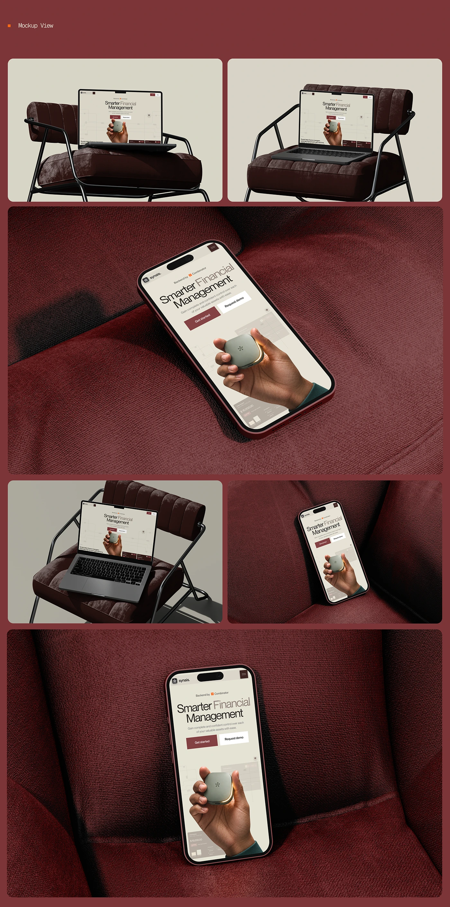

# Synais landing page on laptop and phone mockups posed on a maroon leather armchair and couch

**Discipline:** web · **Design type:** Device mockup scene · **Design style:** Corporate & Clean-Tech
**Tags:** mockup, maroon, leather, laptop, phone, presentation

## What it is
A grid of six realistic device mockups: an open laptop resting on a folding chair's leather seat, a phone lying face-up on a leather couch, and further laptop/phone angles on the same furniture, all showing the Synais hero page.

## What it means
Tactile and premium; leather furniture mockups lend a screen design a physical, editorial presence.

## Techniques
- Pose devices on furniture that matches the brand palette.
- Vary device angle and distance across a mockup set.
- Use consistent lighting across all mockup shots.

## Best for
- Portfolio presentation shots
- Case study mockup grids
- Brand-colour-matched mockups

## Vocabulary
- **Device mockup** — A realistic image showing a design on a physical device.
- **Presentation grid** — Several mockup angles shown together.
