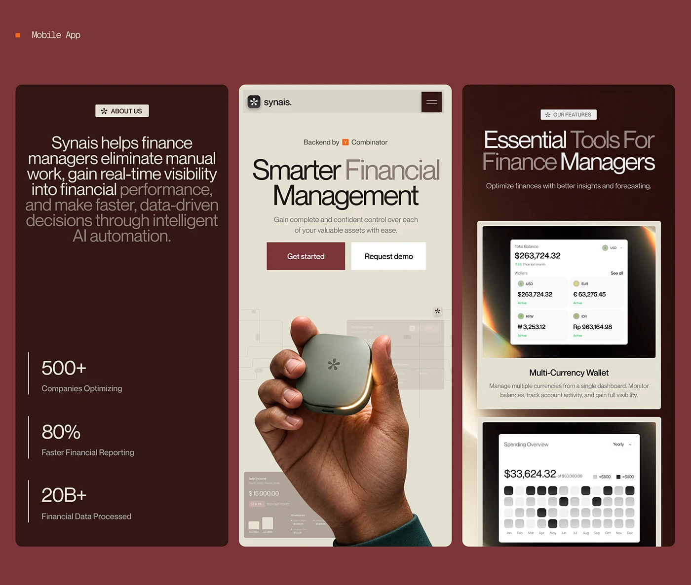

# Synais AI finance SaaS: maroon three-panel spread with a pebble-shaped device and a multi-currency wallet card

**Discipline:** web · **Design type:** SaaS landing page · **Design style:** Corporate & Clean-Tech
**Tags:** fintech, saas, maroon, 3d-render, wallet, hero

## What it is
Three maroon panels: an 'About Us' block with mission text and stats (500+ Companies, 80% Faster Reporting, 20B+ Data Processed), a hero with 'Smarter Financial Management', Get Started/Request Demo buttons and a hand holding a glowing pebble-shaped 3D device, and a features panel with a multi-currency wallet card and a spending-overview heatmap calendar.

## What it means
Premium and trustworthy; the tactile pebble object gives an abstract AI finance tool a physical, brandable identity.

## Techniques
- Invent a signature 3D object to represent an intangible AI product.
- State trust stats early, before the feature list.
- Use a heatmap calendar to visualise spending at a glance.

## Best for
- Fintech SaaS landing pages
- AI product marketing
- B2B dashboards

## Vocabulary
- **Heatmap calendar** — A calendar grid coloured by a value like spend.
- **Signature object** — A custom 3D form used as a brand's visual icon.
