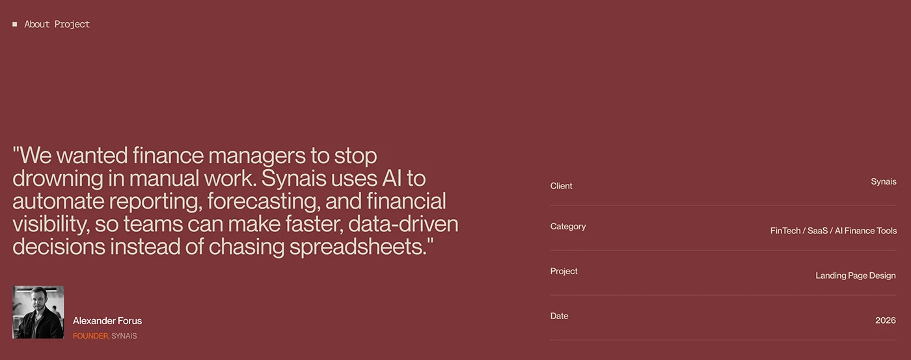

# Synais case study 'About Project' slide: a founder pull-quote beside client, category and date meta rows

**Discipline:** web · **Design type:** Case study slide · **Design style:** Corporate & Clean-Tech
**Tags:** case-study, quote, maroon, meta-data, founder, typography

## What it is
A maroon slide with 'About Project' label, a large pull-quote from the founder about automating financial reporting with AI, his photo and title, and on the right four meta rows (Client: Synais, Category: FinTech/SaaS/AI Finance Tools, Project: Landing Page Design, Date: 2026).

## What it means
Credible and human; a real quote from a named founder grounds an AI product pitch in an actual problem.

## Techniques
- Pair a large pull-quote with the speaker's photo and title.
- List project meta as simple label-value rows.
- Keep the quote focused on the problem, not the solution.

## Best for
- Case study intro slides
- Client testimonial layouts
- Project summary pages

## Vocabulary
- **Pull-quote** — A quotation set in large type to draw attention.
- **Meta row** — A line pairing a label with its value.
